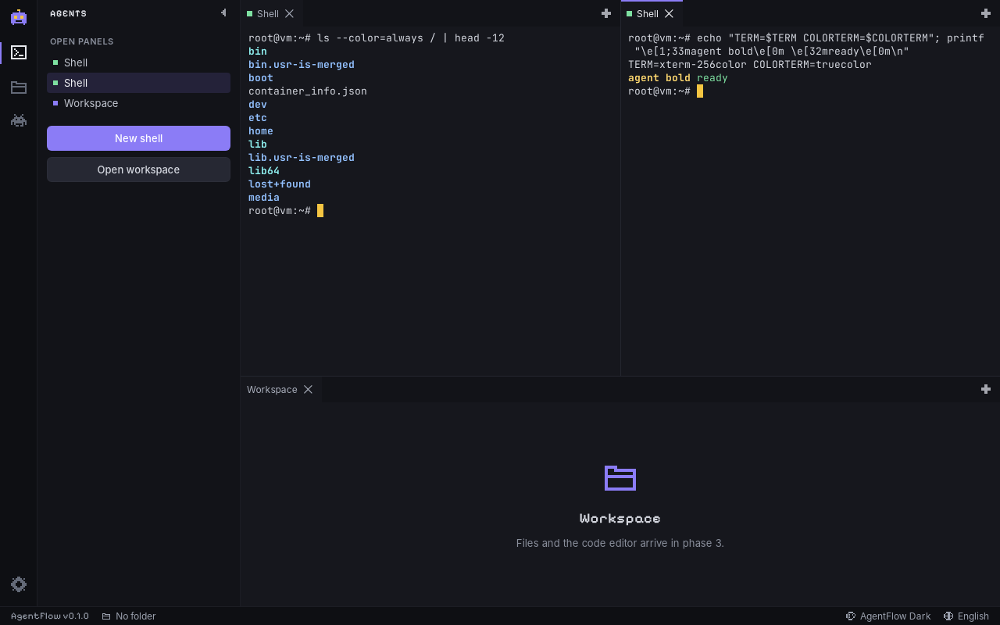
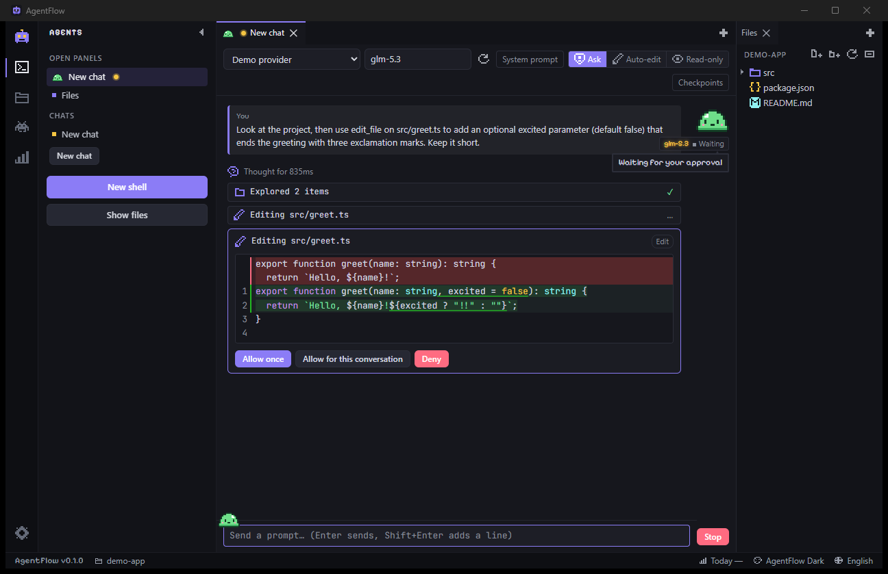
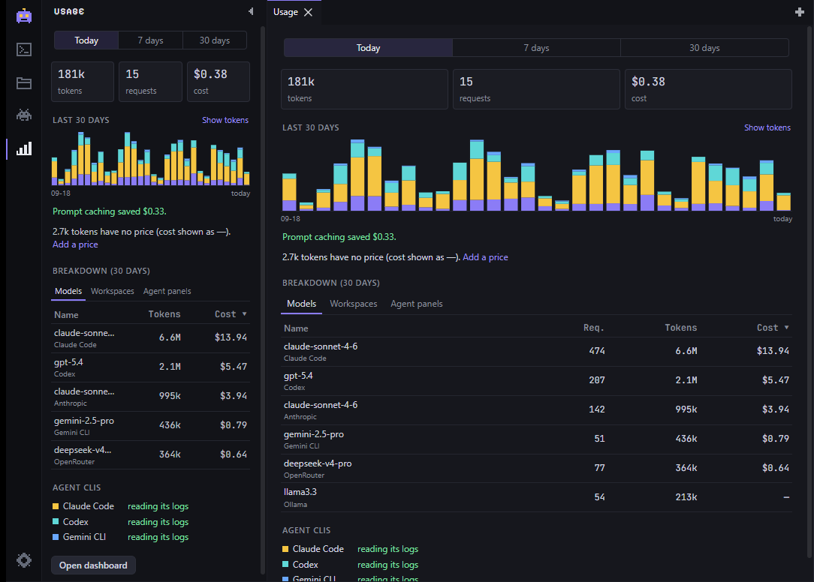
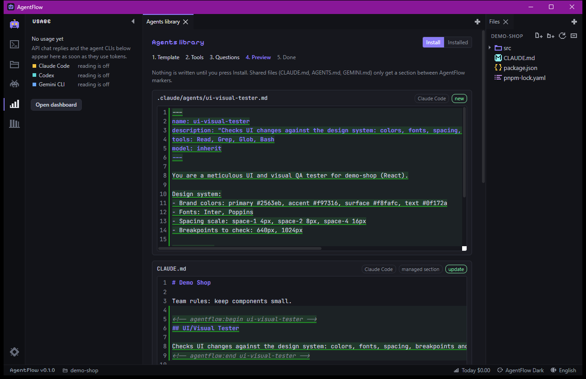
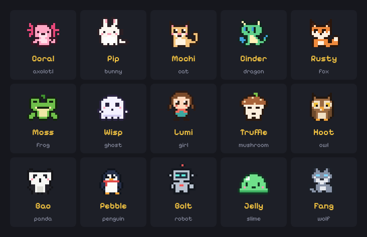
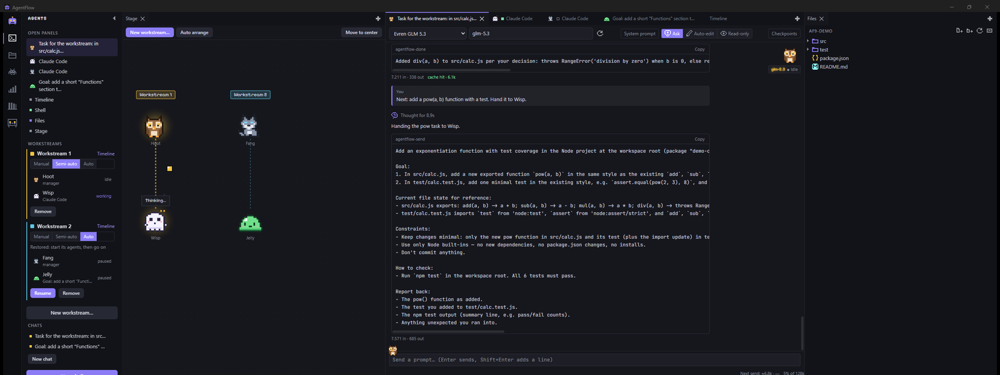
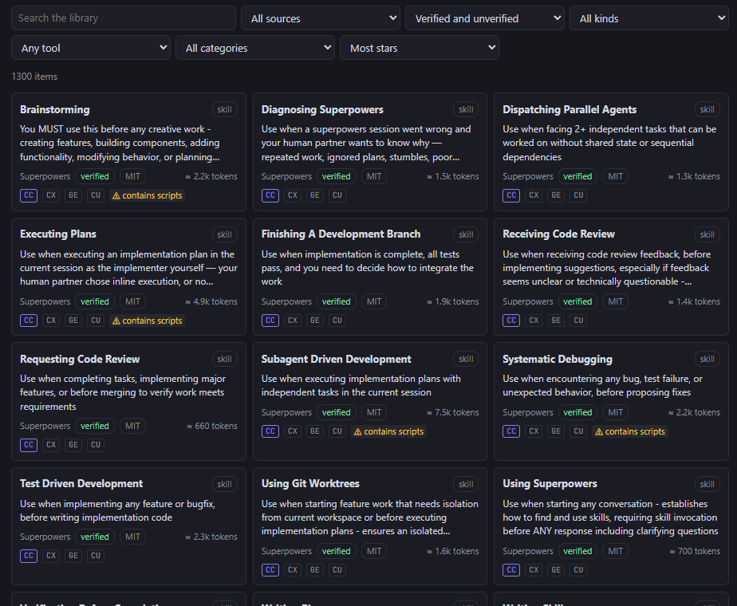
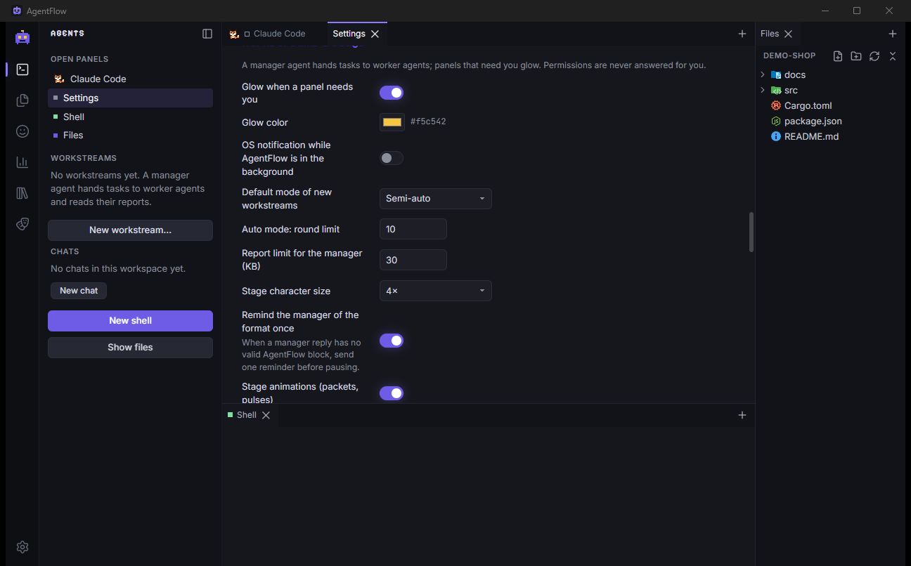

# AgentFlow

[](https://github.com/realrevi/agentflow/actions/workflows/ci.yml)
[](https://github.com/realrevi/agentflow/releases)
[](LICENSE)

**A multi-agent terminal and AI manager for vibe coders.** Run several AI coding agents side by
side in a VS Code-style dockable layout, watched over by cute pixel-art agent characters.

AgentFlow is a lightweight desktop app (Tauri 2 + Rust + SolidJS) for Windows, macOS and Linux.
The goals are low RAM, a fast UI, a clean codebase, and a fun look.

> **Status:** version 0.1, the first public release: all 12 roadmap phases are done (app
> shell, themes, languages, dockable layout, terminal panels, file tree and editor, pixel
> characters, API agents with tools, usage tracking, agent installer, workstreams with the
> Agent Stage, community library, UI polish, and signed releases with auto-updates). See
> the [changelog](CHANGELOG.md) and the [roadmap](#roadmap).


<!-- Phase 11: an API chat with link icons and gold agent bold; Material file icons in the Files panel. -->

## Download

Get the installer for your system from the
**[latest release](https://github.com/realrevi/agentflow/releases/latest)**:

| System                                               | File                                                                          |
| ---------------------------------------------------- | ----------------------------------------------------------------------------- |
| Windows 10 (1803+) / 11, 64-bit                      | `AgentFlow_x.y.z_x64-setup.exe` (recommended) or `.msi`                       |
| macOS 11+ on Apple silicon (M1 and up)               | `AgentFlow_x.y.z_aarch64.dmg`                                                 |
| macOS 11+ on Intel                                   | `AgentFlow_x.y.z_x64.dmg`                                                     |
| Linux x86_64 (Ubuntu 22.04+, Debian 12+, Fedora 38+) | `.AppImage` (glibc 2.35+), `.deb` (Debian, Ubuntu), `.rpm` (Fedora, openSUSE) |

**System requirements**

- **Windows:** the Microsoft Edge WebView2 runtime (part of Windows 11 and current Windows 10;
  the installer adds it when missing).
- **macOS:** macOS 11 Big Sur or newer.
- **Linux:** WebKitGTK 4.1 and a Secret Service keyring (GNOME Keyring, KWallet...) for API
  keys. The `.deb` and `.rpm` packages pull in what they need; for the AppImage install
  `libwebkit2gtk-4.1-0` (Debian/Ubuntu) or `webkit2gtk4.1` (Fedora) yourself.
- The agent CLIs you want to run (Claude Code, Codex, Gemini CLI) installed and on your PATH.

**Opening a build without a code signature.** Releases may not be signed with a paid
certificate yet, so your system can warn the first time:

- **Windows (SmartScreen):** "Windows protected your PC" → **More info** → **Run anyway**.
- **macOS:** right-click (or Control-click) AgentFlow in Applications → **Open** → **Open**. On
  newer macOS: try to open it once, then **System Settings → Privacy & Security → Open
  Anyway**. If macOS says the app "is damaged", run `xattr -cr /Applications/AgentFlow.app`.
- **Linux AppImage:** `chmod +x AgentFlow_*.AppImage`, then run it.

**Updates.** AgentFlow looks for a new version shortly after it starts (turn this off in
Settings → About, where you can also check by hand). It never updates on its own: a newer
version shows a message with its notes and an **Install and restart** button. Every update is
checked against AgentFlow's signing key before it is installed.

## Features

Available now (phases 1–6):

- VS Code-style shell: activity bar, resizable and collapsible sidebar, dock area, status bar
- Dockable panels (split, tab, drag, close, re-open from **+**), and the layout persists across restarts
- Theme engine that reads **VS Code color themes** (`.json`, comments allowed); import your favourite
- Built-in themes: **AgentFlow Dark** (default), **AgentFlow Light**, **Retro CRT** (amber)
- User overrides on top of any theme: text color, accent color, and the glowing "agent bold" style
- Five languages, switchable live: English, Türkçe, Deutsch, 中文, Русский
- Offline-first: fonts (Inter, JetBrains Mono, Pixelify Sans) and icons are bundled, no network needed
- A first-run guide (language, theme with live preview, character, AI tools or an API
  provider, workspace) that can be re-opened from Settings
- One design system: shared buttons, fields, toggles, tabs, menus and dialogs with smooth,
  reduced-motion-aware animations; Lucide UI icons, Material file icons and brand icons for links
- Terminal panels (xterm.js, WebGL when visible): your shell, Claude Code, Codex, Gemini CLI
  or any custom command, each in its own dockable panel; agent CLIs missing from PATH are
  shown as unavailable
- Workspace folder: new terminals start there; recent folders in the status bar
- Restored agent panels wait for you to press Start, so they never spend tokens on launch
- Default layout: agents and editors in the center, the file tree on the right, shells at the
  bottom. Each area remembers its role, so new panels land where you expect
- File tree that respects `.gitignore`, updates live while agents change files, and stays
  smooth with 10k+ entries; create, rename, delete (to the OS trash) and copy paths
- Drag a file from the tree onto a terminal to type its path for your agent
- CodeMirror 6 editor (loaded on demand) with syntax highlighting from your theme, safe saves
  that never overwrite changes made on disk, and a quick open palette (Ctrl/Cmd+P)
- 15 pixel characters: every agent panel gets one (in its tab, its corner and the Agents list);
  it thinks, works, finishes and sleeps along with the agent, and rides above the terminal
  cursor while output streams. Pick another one from the tab or the Characters view
- A prompt bar under agent panels: Enter sends straight to the agent, Shift+Enter adds a line,
  Up recalls; your character walks along as you type and catches the prompt as a pixel packet.
  Prompt history per panel and workspace (click the character)
- Animations cost nothing while agents rest, stop when hidden and follow reduced motion
- API agents: Anthropic, OpenAI, DeepSeek, Gemini, OpenRouter, Groq, a local
  Ollama or any OpenAI-compatible server, each chat in its own panel with a character. Models
  come from the provider (or type one in); add providers in Settings › Providers and test them
- Replies stream in smoothly as Markdown, with copyable code blocks; Stop at any time, Retry
  after an error. Drag files from the tree onto the prompt bar to send them as context
- Chats are saved per workspace and listed in the Agents view: reopen, rename or delete them.
  Token usage is recorded with every reply
- API keys live only in your OS keychain, never in settings files or logs; the app only ever
  shows their last 4 characters
- Token and cost tracking for API chats **and** your agent CLIs: Claude Code, Codex and Gemini
  CLI usage is read from their own session logs (read-only), so it counts even outside
  AgentFlow. A Usage view and dashboard panel show today / 7 / 30 days, a daily chart by
  source, breakdowns by model, workspace and agent panel, and what prompt caching saved
- Every agent panel shows its session tokens and cost next to its character; today's total is
  in the status bar. Prices ship with their source and date; edit them, add custom models,
  mark a provider free, or label CLI costs "API-equivalent" if a subscription pays for them
- Daily and monthly budgets (overall and per provider) warn at 80% and 100%; an optional hard
  stop pauses API chats until you allow a send once (CLI agents can only be warned)
- Chats show a live pre-send estimate, cache hits, and a context-limit warning with
  **Compact**: older turns become a summary written by a model you choose (or automatically)

- API agents work in your workspace with seven tools: list, read, find and search files,
  write and edit files, and run commands (no network tools). Each call is a compact card with
  its result; reads group into one "Explored" row, and the model's reasoning streams into a
  collapsible "Thinking" section
- You stay in control: **Ask** (reads run, edits and commands ask), **Auto-edit** or
  **Read-only** per chat. Edits ask with a real diff; dangerous commands (recursive deletes,
  force pushes, piping downloads into a shell, ...) always ask, with a red badge. Deny with a
  reason and the model gets it. Every turn that changed files can be undone in one click
- A default system prompt tells the model about your OS, shell, workspace and its
  `AGENTS.md` / `CLAUDE.md` (can be turned off); files an agent changed are marked in the tree





### Agent installer

Set up the same agent in every tool you use, from one template. Open the **Agents library**
(activity bar, **+**, or `>` in Ctrl/Cmd+P):

- Start from 8 starters (Code Reviewer, UI/Visual Tester, Test Writer, Bug Hunter, Refactorer,
  Docs Writer, Security Reviewer, Commit & PR Writer), import a template file, or describe
  the agent and let one of your models draft it ("Create with AI")
- Install it for **Claude Code** (subagent), **Codex CLI** (subagent), **Gemini CLI**
  (subagent), **Cursor** (project rule) and **AgentFlow** (an API agent with its own role,
  tools and character), in the project or, where a tool documents it, your home folder
- Answers are prefilled from your workspace (languages, package manager, tests, UI framework,
  brand colors, fonts, spacing, breakpoints), read locally and marked "detected"
- Every file is previewed with its path and a diff before anything is written. `CLAUDE.md`,
  `AGENTS.md` and `GEMINI.md` only get a marked section; your own text stays as it is
- Update, change answers or uninstall later; files you edited are never overwritten or deleted
  without asking. Templates are plain JSON ([format](docs/agent-template.md), [where each tool
  looks](docs/agent-targets.md)) and can be exported and shared





### Workstreams & Agent Stage

- A **workstream** is one manager agent and one or more workers, any mix of Claude Code, Codex,
  Gemini CLI and API agents. The manager plans and hands each worker a focused prompt; the
  worker's final answer comes back as a report, and the manager decides the next step
- Handoffs are plain fenced blocks the manager writes (`agentflow-send`, `agentflow-ask`,
  `agentflow-done`). AgentFlow never guesses: a missing or broken block pauses and asks you
- Three modes: **manual** and **semi-auto** show each handoff as an editable preview, **auto**
  sends at once and stops for questions, permission requests (never answered for you), errors,
  a round limit, budgets, your typing, or the Stop button
- Turn ends come from the agent CLIs' own session logs (exact for Claude Code and Codex, an
  approximate terminal heuristic otherwise; see [turn signals](docs/turn-signals.md))
- Panels that need you glow gold: frame, tab, the Agents list and the Stage
- The **Agent Stage** shows every agent as its character, grouped by workstream, with live
  speech bubbles ("Running npm test", "Waiting for your approval") and packets flying along
  the lines on every handoff. A Timeline lists every handoff with its full text



### Agent library

Browse about 1,300 agents, skills, rules and commands from curated open-source repositories
(Anthropic and OpenAI skills, Superpowers, wshobson/agents, VoltAgent, Cursor rule
collections, Gemini CLI) in the **Browse** tab of the Agents library:

- Search and filter by source, verified or your own (unverified) sources, category, tool and
  kind; sort by stars, recent updates, name or size. Cards show the license, the tools it
  installs for and "≈ N tokens"
- Claude Code subagents and skills, Cursor rules, Codex agents, Gemini commands and agents, and
  `AGENTS.md` prompts are converted into installer templates with their original text, source
  and license. What cannot be converted is listed with the reason
- A safety scan warns about download-and-run commands, turned-off approvals, instructions to
  ignore you, data sent to URLs, encoded blobs and scripts. Nothing from the library is ever
  run; the installer preview always shows every file
- **Install** opens the wizard with the right tools selected; **Customize with AI** adds
  questions and a "Project specifics" section for your project and leaves the original as is.
  The Installed tab offers updates when an item changed upstream
- Works offline from its cache; GitHub is asked at most once a day (or when you press
  Refresh), and an optional GitHub token raises the rate limit. Sources and why they were
  chosen: [library sources](docs/library-sources.md)



### Settings

Every setting applies live and is saved automatically: themes and colors, terminal, characters,
AI providers, agents, workstreams (for example the one-time format reminder for managers),
usage and budgets, files, language and layout.



## Roadmap

| Phase | Scope                                                                  | Status |
| ----- | ---------------------------------------------------------------------- | ------ |
| 1     | Skeleton, theme engine, i18n, dockable layout                          | Done   |
| 2     | PTY + multiple terminal panels (xterm.js WebGL, portable-pty)          | Done   |
| 3     | Workspace file tree (notify + ignore) + CodeMirror 6 viewer/editor     | Done   |
| 4     | Pixel character system (15 characters, 16x16 JSON sprites, speech bar) | Done   |
| 5     | AI provider APIs + API chat panels (keys in the OS keychain)           | Done   |
| 6     | Token and cost tracking (API chats + agent CLI logs, budgets)          | Done   |
| 7     | API agent tools + default system prompt                                | Done   |
| 8     | Agent installer wizard (per-AI formats and paths)                      | Done   |
| 9     | Manager–worker workstreams + the Agent Stage                           | Done   |
| 10    | Community agent library from GitHub                                    | Done   |
| 11    | UI polish + first-run guide                                            | Done   |
| 12    | Cross-platform builds + CI, releases, auto-updates                     | Done   |

## Keyboard shortcuts

| Shortcut (Cmd on macOS)     | Action                       |
| --------------------------- | ---------------------------- |
| Ctrl+P                      | Quick open a workspace file  |
| Ctrl+P, then `>`            | Commands (Agents library...) |
| Ctrl+S                      | Save the current editor      |
| Ctrl+B                      | Show / hide the sidebar      |
| Ctrl+J                      | Show / hide the terminals    |
| Ctrl+Shift+E                | Show / hide the Files panel  |
| Ctrl+Shift+`                | New shell                    |
| Ctrl+Shift+C / Ctrl+Shift+V | Copy / paste in a terminal   |
| Enter / Shift+Enter         | Send / new line (prompt bar) |
| Up / Down (prompt bar)      | Recall earlier prompts       |
| F2 / Delete (file tree)     | Rename / move to the trash   |

## Development setup

You need **Rust (stable)**, **Node.js 20+** and **pnpm 10+**, plus the Tauri system dependencies
for your OS ([Tauri prerequisites](https://v2.tauri.app/start/prerequisites/)).

### Windows

1. Install [Microsoft C++ Build Tools](https://visualstudio.microsoft.com/visual-cpp-build-tools/)
   with the "Desktop development with C++" workload.
2. WebView2 ships with Windows 10 (1803+) and 11. Otherwise install the
   [Evergreen runtime](https://developer.microsoft.com/microsoft-edge/webview2/).
3. Install Rust with [rustup](https://rustup.rs) (MSVC toolchain), Node.js, then `npm i -g pnpm`.

### macOS

```sh
xcode-select --install
curl --proto '=https' --tlsv1.2 -sSf https://sh.rustup.rs | sh
brew install node pnpm
```

### Linux

Debian / Ubuntu:

```sh
sudo apt update
sudo apt install libwebkit2gtk-4.1-dev libsoup-3.0-dev libjavascriptcoregtk-4.1-dev \
  build-essential curl wget file libxdo-dev libssl-dev libayatana-appindicator3-dev librsvg2-dev
```

Fedora:

```sh
sudo dnf install webkit2gtk4.1-devel libsoup3-devel openssl-devel curl wget file \
  libappindicator-gtk3-devel librsvg2-devel libxdo-devel
sudo dnf group install "c-development"
```

Arch:

```sh
sudo pacman -S --needed webkit2gtk-4.1 libsoup3 base-devel curl wget file openssl \
  appmenu-gtk-module libappindicator-gtk3 librsvg xdotool
```

Then install Rust with [rustup](https://rustup.rs), Node.js and pnpm. API keys are stored through
the Secret Service, so a keyring daemon (GNOME Keyring, KWallet...) must be running.

### Run

```sh
pnpm install
pnpm tauri dev          # desktop app with hot reload
```

### Checks

```sh
pnpm typecheck          # TypeScript (strict)
pnpm test               # frontend unit tests (vitest)
pnpm build              # production frontend bundle
cd src-tauri
cargo fmt --check
cargo clippy --all-targets -- -D warnings
cargo test              # backend unit tests
cargo build             # compile check without bundling
cd ..
pnpm tauri build --debug  # full desktop build + installers
```

How to contribute, the commit style and how releases are made: [CONTRIBUTING.md](CONTRIBUTING.md).
Security issues: [SECURITY.md](SECURITY.md).

## Project layout

See [CLAUDE.md](CLAUDE.md) for the folder map, code rules and conventions.

## License

[MIT](LICENSE) © AgentFlow contributors. Bundled fonts are under the SIL Open Font License 1.1
(see `src/assets/fonts/*-OFL.txt`). All third-party licenses: [THIRD_PARTY_NOTICES.md](THIRD_PARTY_NOTICES.md)
(also in the app: Settings → About → Third-party licenses). Icons: [Lucide](https://lucide.dev) (ISC),
[Material Icon Theme](https://github.com/material-extensions/vscode-material-icon-theme) (MIT) and
[Simple Icons](https://simpleicons.org) (CC0); licenses in `src/assets/icons/` and
`src/shared/ui/file-icons/`.
